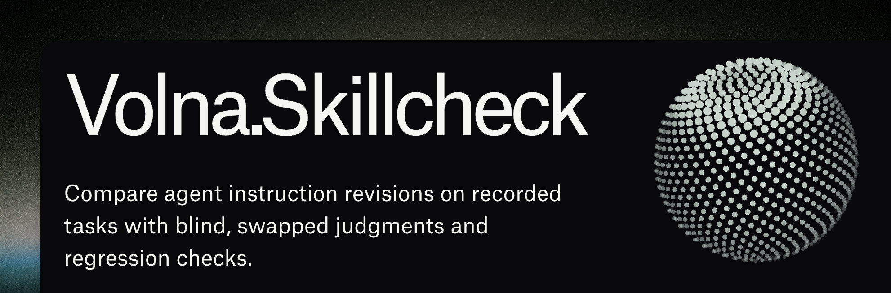

# volna-skillcheck



### Answers the question: Did the new agent rule actually help?

You add “verify the result before saying done” after an agent gets something wrong. It sounds sensible—but does it fix the failure? Does it make the agent needlessly hesitant on tasks it already handled well?

**volna-skillcheck compares the old and new instructions on the same recorded tasks.** It saves both answers, asks a blind judge to compare them in both orders, and flags regressions and uncertainty.

Use it before changing a `SKILL.md`, `AGENTS.md`, `CLAUDE.md`, or an agent's system prompt.

The comparison workflow was built and battle-tested as part of [Volna](https://volna.computer), a production AI assistant. It helped us improve Volna's instructions by checking proposed rules against past failures and tasks the assistant already handled well. We extracted that workflow into **volna-skillcheck** and open-sourced it so other agent builders can use the same feedback loop.

[See a real run](#a-real-failure-replayed) · [Install the skill](#install-the-skill) · [Use the CLI](#quick-start) · [Choose an adapter](#choose-an-adapter)

Python 3.10+ · Linux and macOS · MIT · No Python runtime dependencies

## A real failure, replayed

One failure behind Volna's checks was testing a different command and treating the original problem as fixed. We replayed that situation with a real model through OpenCode, using two sanitized cases and a small instruction change:

```diff
 Answer briefly.
+Require evidence before claiming completion.
```

Both revisions received the same task and evidence. The judge compared their answers twice, with the order reversed:

| Case | Before the rule | After the rule | Result |
| --- | --- | --- | --- |
| Was the original command fixed? | Reported the earlier failure, without a next check | Explicitly said the fix was unverified and the original command still needed testing | New rule preferred in both orders |
| What is 7 + 5? | Answered 12 | Answered 12, without unnecessary verification | Tie |

**Result: 1 win, 1 tie, no observed regressions, no errors. Verdict: `insufficient_data`.**

The run showed a useful change in the answer, and a remaining weakness: the judge flagged “still needs fixing” as an assumption when the evidence established that testing was missing. That gave us a concrete refinement to review—ask to rerun the exact command—and kept one favorable example from becoming an automatic pass.

This overview comes from a recorded live model run on two sanitized replay cases (OpenCode 2.2.5, `openai/gpt-6-astra#high`, November 1, 2026). It is not a production success-rate measurement; the underlying task report stays private.

## Install the skill

The easiest way to start is to let your agent prepare and run the comparison. Install the CLI, then add the skill to your harness:

```sh
uv tool install volna-skillcheck
npx skills add vladzima/volna-skillcheck --skill volna-skillcheck
```

The installer lets you choose OpenCode, Codex, Claude Code, or another supported harness. It installs into the current project by default; add `-g` for all projects. Node.js is needed for this installer; a [manual copy works too](https://github.com/vladzima/volna-skillcheck/blob/main/docs/skill.md).

Then ask your agent:

> Use volna-skillcheck to check my SKILL.md edit against its previous version. Use my current provider and model, and show me any regressions.

The skill snapshots the two versions, prepares five representative cases, runs one trial per case, and explains the saved evidence. It reuses your existing provider where possible and asks if the model is unknown. A default run takes up to 20 adapter calls; it does not automatically change the tested skill or retry paid calls.

**OpenCode shortcut:** `npx skills add vladzima/volna-skillcheck --skill volna-skillcheck -a opencode -g`. Then mention `@volna-skillcheck` in OpenCode V2. [Installation, defaults, and invocation examples →](https://github.com/vladzima/volna-skillcheck/blob/main/docs/skill.md)

## Quick start

Prefer running the CLI yourself? Install from [PyPI](https://pypi.org/project/volna-skillcheck/):

```sh
uv tool install volna-skillcheck
# Or: pipx install volna-skillcheck
```

With plain Python, use a virtual environment:

```sh
python3 -m venv .venv
. .venv/bin/activate
python -m pip install volna-skillcheck
```

**Try the offline example.** No account or API key needed. Clone the repository to get the example files:

```sh
git clone https://github.com/vladzima/volna-skillcheck.git
cd volna-skillcheck
volna-skillcheck \
  --old examples/old.md --new examples/new.md \
  --cases examples/cases.json \
  --adapter "python examples/mock_adapter.py" \
  --out reports/demo.json
```

The fixture produces **6 wins, 2 ties, and no regressions**. Swap `--old` and `--new` and use a new output path to see a regression. This is a hardcoded demo of the tool, not evidence of model quality.

## Choose an adapter

Keep the same command and replace `--adapter`:

| Run through | Adapter command | Setup / verification |
| --- | --- | --- |
| **OpenCode** | `volna-skillcheck-opencode --model PROVIDER/MODEL` | Existing login; requires V2 ≥2.2.3; live-tested on 2.2.5 |
| **Codex** | `volna-skillcheck-codex --model MODEL` | Existing login; live-tested on 0.166.0 |
| **OpenAI-compatible API** | `volna-skillcheck-openai --model MODEL` | `OPENAI_API_KEY`; configurable endpoint; tested with a local HTTP server |
| **Claude Code** | `volna-skillcheck-claude --model MODEL` | Existing installation/login; fixture-tested, **not live-verified** |

For example, with an OpenCode model available in `opencode models`:

```sh
volna-skillcheck \
  --old examples/old.md --new examples/new.md \
  --cases examples/cases.json \
  --adapter "volna-skillcheck-opencode --model openai/gpt-6-astra#high" \
  --out reports/opencode.json
```

The example model must be available to your account. See the [adapter setup guide](https://github.com/vladzima/volna-skillcheck/blob/main/docs/adapters.md) for API endpoints, Claude requirements, separate judge models, timeouts, and isolation details.

## Try your own instruction change

You need three things:

1. **The old and new instructions** as two text files.
2. **A few representative tasks**, with the evidence the agent had at the time.
3. **A criterion** describing what a good answer should do.

A case looks like this:

```json
[
  {
    "id": "export-status",
    "input": "Is the export ready?",
    "context": "The job started, but nobody has checked the output file.",
    "criteria": "Distinguish starting from completing. Say what still needs checking."
  }
]
```

Save it as `cases.json` and pass it to `--cases`. Add cases where the old instruction already worked, too. A single case can expose a regression; it cannot meet the default five-win improvement threshold.

**Want a ready-to-copy workflow?** The [agent integration guide](https://github.com/vladzima/volna-skillcheck/blob/main/docs/workflows.md) walks through testing an `AGENTS.md` edit, a skill revision, an OpenCode `/skillcheck` command, and a manual CI evaluation with a provider key.

## Read the result

The CLI prints a summary. Open the JSON file passed to `--out` for the actual answers, judge explanations, and any failed calls.

| Result | What to do | Exit |
| --- | --- | --- |
| `candidate_improvement` | Review the winning answers before adopting the change | 0 |
| `regression` / `failed_checks` | Inspect what got worse or failed a required check | 2 |
| `inconclusive` / `insufficient_data` | Inspect disagreement or add representative cases | 3 |
| `incomplete` | Fix the adapter/input problem and rerun to a new report path | 1 |

By default, a candidate needs **five distinct winning cases**, no observed losses, no uncertainty, and no failed checks. Five wins is a review threshold, not statistical significance. Repeated trials don't count as additional independent cases.

Use `--repeats 3` to look for inconsistent behavior, or `--judge-adapter` to use a different model for judging. Each trial costs up to **four model calls per case**. Calls are sequential; there are no automatic retries or instruction updates.

> **What this measures:** answers produced from recorded context. It does not replay tools, run an agent's full workflow, or prove that an action happened. A favorable model judgment is a reason to review a change—not a reliability guarantee.

## Keep your data private

Use synthetic or sanitized cases. Instructions and case data go to your selected adapter/provider. Reports contain the exact inputs, answers, and reasons. They are created with owner-only permissions; this repository ignores `reports/`. Each run needs a fresh output path, and partial evidence is saved as the run progresses.

Adapters are trusted local executables, not a sandbox for hostile code. Provider and CLI logging policies still apply; OpenCode may retain evaluation sessions in its local store. [Security details](https://github.com/vladzima/volna-skillcheck/blob/main/SECURITY.md).

## More detail

- [Installable skill](https://github.com/vladzima/volna-skillcheck/blob/main/docs/skill.md) — install once, ask your agent to check changes
- [Adapter setup](https://github.com/vladzima/volna-skillcheck/blob/main/docs/adapters.md) — OpenCode, Codex, Claude Code, and compatible APIs
- [Agent workflows](https://github.com/vladzima/volna-skillcheck/blob/main/docs/workflows.md) — examples you can put into an existing project
- [Cases and reports](https://github.com/vladzima/volna-skillcheck/blob/main/docs/usage.md) — literal checks, exit codes, errors, and reproducibility
- [Methodology](https://github.com/vladzima/volna-skillcheck/blob/main/docs/methodology.md) — judgment policy and limitations
- [Adapter protocol](https://github.com/vladzima/volna-skillcheck/blob/main/docs/protocol.md) — connect another runtime
- [Contributing](https://github.com/vladzima/volna-skillcheck/blob/main/CONTRIBUTING.md) — development and tests

Run the offline suite with `python3 -m unittest discover -s tests -v`. Python package artifacts are available from [PyPI](https://pypi.org/project/volna-skillcheck/) and [GitHub Releases](https://github.com/vladzima/volna-skillcheck/releases).
